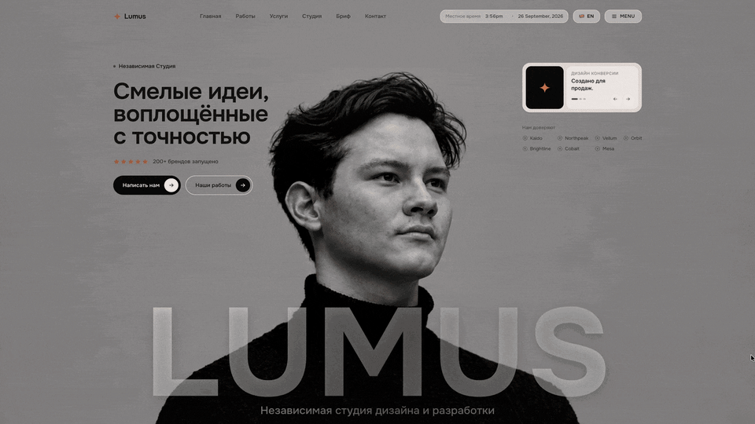

# Lumus

**Имиджевый сайт дизайн-студии**

[Открыть демо](https://vagapov-studio.netlify.app/portfolio/lumus/site/)

## Задача

Передать характер креативной студии и провести посетителя от первого впечатления к знакомству с работами и обсуждению проекта.

## Возможности

- Выразительный первый экран с крупной типографикой.
- Интерактивный фон и анимация интерфейса.
- Избранные работы и направления услуг.
- Бриф и контакты для обсуждения задачи.
- Адаптация композиции для компьютера и телефона.

## Реализация

HTML, CSS, JavaScript и Canvas API. Движение поддерживает иерархию контента и образ студии.

Проектирование сценариев, дизайн интерфейса, адаптация и разработка — Vagapov Studio.

## Статус

Демонстрационный имиджевый сайт. Представленные бренды и контент показывают сценарий подачи работ и не являются списком клиентов Vagapov Studio.

## Связаться

[Обсудить проект в Telegram](https://t.me/vagapov_studio) · [Написать на почту](mailto:vagapov.studio.pro@gmail.com) · [Сайт студии](https://vagapov-studio.netlify.app/)

---

Публичный кейс: описание, изображения и ссылки на демонстрацию. Исходный код проекта закрыт.
